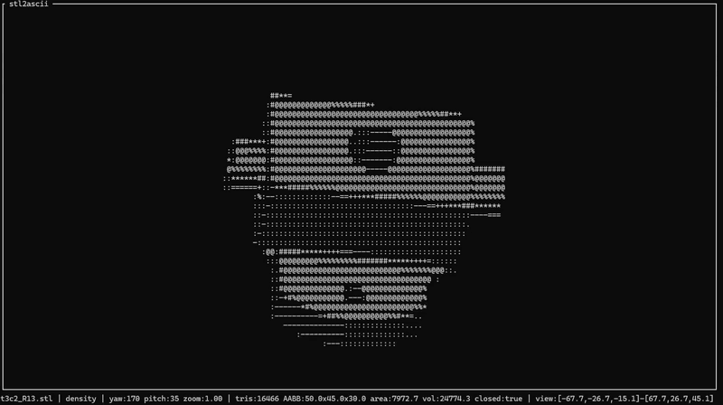

# stl2ascii

#### **stl2ascii** is a text-based viewer for 3D files in STL format; it was created primarily to support LLMs that lack vision capabilities when working with 3D models. ASCII STL 3D viewer - interactive TUI with stdio MCP support.



Loads ASCII/binary STL. Measurement tools first; ASCII render for confirmation. `clip` is a **hard geometric cut** (camera auto-fits the box unless `focus`/`radius` are set).

## Build

```powershell
cargo build --release
```

## MCP (primary)

```powershell
stl2ascii mcp
```

```json
{
  "mcpServers": {
    "stl2ascii": {
      "command": "./target/release/stl2ascii",
      "args": ["mcp"]
    }
  }
}
```

Tools: `render_stl`, `render_overlay`, `render_deviation`, `mesh_stats`, `mesh_diff`, `volume_in_box`, `is_inside`, `slice`, `list_presets`, `list_shade_modes`.  
Full semantics live in MCP `instructions` and per-tool schemas.

Conventions: local paths; `clip`/`box` = `[x,y,z,dx,dy,dz]`; overlay glyphs `#`/`%`/`*`; `volume_in_box` grid max 64 (`estimated_error` = one voxel volume).

## CLI (short)

```text
stl2ascii [OPTIONS] [FILE]
stl2ascii mcp
stl2ascii stats <FILE> [--b OTHER] [--clip …]
stl2ascii diff <A> <B> [--clip …]
stl2ascii volume-in-box <FILE> --box …
stl2ascii overlay <A> <B> [--clip …]
stl2ascii deviation <FILE> --ref <REF> [--clip …]
stl2ascii is-inside <FILE> --point x,y,z [--clip …]
stl2ascii slice <FILE> --axis x|y|z --value V [--clip …]
```

### Examples

```powershell
.\target\release\stl2ascii.exe .\corpus\t3c2_R13.stl --preset iso --snapshot
.\target\release\stl2ascii.exe .\corpus\t3c2_R13.stl --clip 0,0,10,20,20,10 --snapshot --width 80
.\target\release\stl2ascii.exe overlay .\corpus\t3c2_R13.stl .\corpus\t3c2_R13.stl --preset iso --width 60
```

Keys (interactive): arrows/hjkl rotate · +/- zoom · wasd pan · m shade · r reset · q quit

## License

MIT
